# FinTec Investment Research Assistant: User Workflow & Decision Playbook

**Version:** 1.0, prepared 2026-11-10
**Audience:** the owner/user (a US young professional with a 401(k) and match, a Roth/Traditional IRA, and a taxable brokerage account; 10+ year horizon; moderate risk tolerance; about $20K in savings), plus the developer who maintains the knowledge base (KB).

> **Not financial advice.** The app is a decision-support tool. It runs deterministic rules from a curated, cited knowledge base on numbers the user enters and on free live data. Every rule below can be overridden by the user. Every figure shown in the app carries a source and an `as_of` date.

> **Document set.** `docs/README.md` indexes everything. `SPEC.md` is canonical for thresholds, formulas and requirement IDs; `IMPLEMENTATION_PLAN.md` is canonical for page and file names (used verbatim below); this playbook is canonical for when and how each flow runs.

---

## 0. How to read this playbook

### 0.1 Source keys
Each key decision cites the research brief that supports it:

| Key | Brief (in `docs/research/`) | Use it for |
|---|---|---|
| **[AE]** | `academic_evidence.md` | Peer-reviewed evidence, guardrail thresholds, scoring weights |
| **[CR-A]** | `influencers_ben_felix_plain_bagel_whiteboard_graham.md` | Felix, Plain Bagel, Whiteboard Finance, Graham Stephan: principles, conflicts, trust weights |
| **[CR-B]** | `influencers_tilbury_jikh_carlin_carlson.md` | Tilbury, Jikh, Carlin, Carlson: principles, frameworks, conflicts |
| **[MC]** | `market_context_2026.md` | Nov 2026 market regime, CMAs, popular products, refresh checklist |
| **[SA]** | `savings_and_account_strategy.md` | Cash vehicles, EF sizing, account order of operations, 2026 limits, $20K algorithm |
| **[TS]** | `tech_stack_and_data_sources.md` | Data sources, rate limits, KB layout, LLM layer |

> `analysis_methodology.md` was listed as an input but **does not exist** in `docs/research/` as of 2026-11-10. The stock-scorecard and valuation steps below therefore rely on the scoring weights in [AE] §12 and the creator frameworks in [CR-A]/[CR-B] (Plain Bagel's research process, Carlin's intrinsic-value method, Carlson's moat checklist). When that brief exists, reconcile §6 against it.

### 0.2 Five rules that run through every flow
1. **Core-satellite by default.** Broad low-cost index ETFs make up at least 80% of equities. Individual stocks default to a cap of 10% of equities (warn above 10%, strong warning above 20%); each single stock warns above 5% of investable assets and gets a strong warning above 10% (SPEC FR-104, FR-413). Sources: Sharpe 1991, Bessembinder 2018, Statman 1987, Domian et al. 2007 [AE §1.1, §2.1, §7.1].
2. **Rules make decisions; creators and LLMs explain.** No creator ticker is ever a buy signal by itself. Sponsored or paid-promotion mentions are excluded from scoring [CR-A §7.1; CR-B §6.1]. The LLM never produces numbers or trade calls [TS §4, §6].
3. **Low frequency.** No real-time ticker view. A decision journal entry and a 48-72 hour cooling-off period are required before any new stock buy is marked "ready" (Barber & Odean 2000; Barber et al. 2022) [AE §6.1].
4. **Valuation sets expectations, not timing.** CAPE and forward P/E feed expected-return ranges only. They never produce "sell" or "go to cash" advice (Campbell & Shiller 1998; Goyal & Welch 2008) [AE §8; MC §1].
5. **Freshness is visible.** Every number shows `as_of`. Values older than their refresh cadence turn amber; older than twice the cadence turn red and are excluded from scores and from any "Ready" decision (SPEC NFR-04, FR-109) [MC §9; TS §5.4]. Creator picks expire after 120 days, commentary after 60 days, and positions after 365 days [CR-B §6.1; CR-A §7.2].

### 0.3 App pages referenced below
These are the page files defined in `IMPLEMENTATION_PLAN.md` §1 (and SPEC §9.1):

| Page | Purpose |
|---|---|
| `Home` | Regime banner, task inbox (what's due this month/quarter/year), staleness alerts, KB health card |
| `0_Profile` | Profile, risk questions, IPS (write, sign, review) |
| `1_Savings_and_Emergency_Fund` | EF sizing, $20K split, HYSA/T-bill/MMF/CD/I-bond after-tax comparison, tax on interest |
| `2_Account_Order_of_Operations` | Contribution waterfall, Roth vs Traditional, backdoor pro-rata, 2026/2027 limits |
| `3_ETF_Explorer` | ETF scorecard, fees, overlap, look-through concentration, factor regression |
| `4_Portfolio_and_Accounts` | Holdings, allocation, rebalancing, stress tests, Monte Carlo, contributions, TLH |
| `5_Stock_Research` | Screener, style scorecards, valuation, dividend safety, portfolio fit |
| `6_What_Experts_Say` | Creator stances next to the research verdict, conflict flags, video digest, "I just saw a pitch" |
| `7_Research_Library` | Papers with evidence tier, findings, caveats |
| `8_Market_Context` | Snapshot cards, regime banner, CMAs (descriptive only) |
| `9_Decision_Journal` | Theses, pre-trade checklist, cooling-off timers, sell checklist, reviews |
| `10_Ask_the_KB` | Optional LLM Q&A grounded in KB citations (keyword search when no LLM) |
| `11_Settings` | Keys, LLM provider, refresh jobs, data-source status, backups |

### 0.4 Workflow map

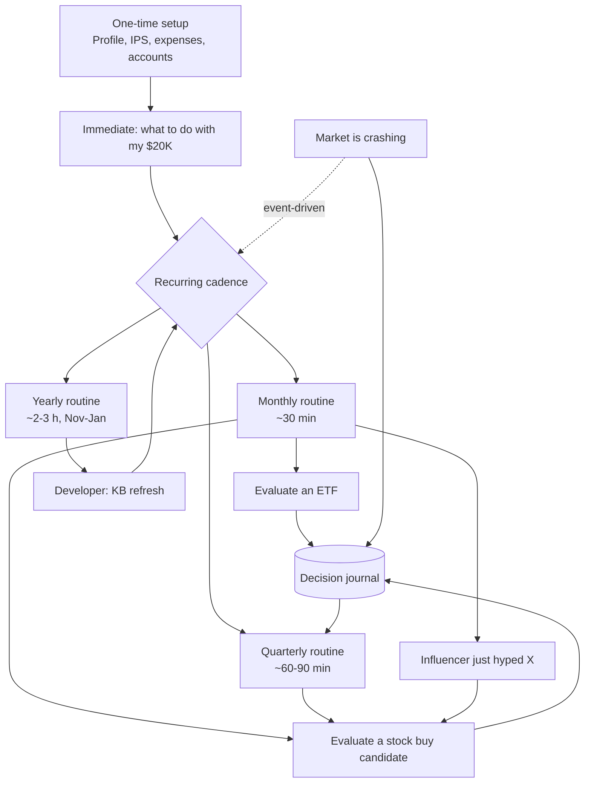

---

## 1. One-time setup (about 60-90 minutes)

**Goal:** give the rule engine the inputs it needs. Nothing in the app is personalized until this is done. The `Home` page shows a setup checklist until every required field is filled.

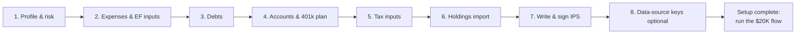

### 1.1 Profile and risk (`0_Profile`)
| Field | Default | Why it matters |
|---|---|---|
| Age, horizon | 10+ years | Lifecycle logic: young workers with stable income can justify high equity (Ayres & Nalebuff 2013), but **never leverage** for a moderate profile [AE §9] |
| Risk tolerance | Moderate | Sets the guardrails in [AE §12] |
| Drawdown question: *"If your portfolio fell 30% and stayed down for 2 years, what would you do?"* (sell / hold / buy more) | — | "Sell" moves the default equity share down a notch and turns on staged deployment |
| Lump-sum question: *"If the market fell 20% the week after you invested, would you keep going?"* | — | "No" pre-selects a 6-month staged plan [AE §10] |
| Tracking-error tolerance: *"Could you hold a fund that lags the S&P 500 for 10 years?"* | — | Gates any factor tilt above 10% [AE §3.1; MC §5] |
| Interests (multi-select) | value/quality, factor ETFs, dividend growth, growth | Turns on the matching screener presets and explainers |

### 1.2 Expenses and emergency-fund inputs (`1_Savings_and_Emergency_Fund`)
- **M = monthly *essential* expenses.** This is required and has no default [SA §4.1]. Essentials are rent, utilities, groceries, insurance, minimum debt payments, transport, and healthcare out of pocket. Leave out discretionary spending [SA §2.2]. If you don't know M, the app offers Graham Stephan's "track all expenses for 60 days" mode [CR-A §4.4] and uses a provisional M from a 3-question estimate, flagged "provisional".
- **Adjustment flags** [SA §2.2]: single vs. dual income, variable pay, job security, specialized role, dependents, homeowner or older car, HDHP without HSA cash, health costs, and Roth contribution basis as a backstop. The **macro overlay** (BLS long-term unemployment share above 25%, which was 27.6% in Oct 2026) adds 0.5 month automatically.
- **Known expenses within 36 months** (amount and date). These become sinking funds, never equities [SA §4.6].

### 1.3 Debts
Enter balance, APR, and minimum payment for each debt. Rules [SA §3.1; CR-A §4.2]:
- APR above ~8%: "high-interest". Pay it off from cash above the starter EF, highest APR first (avalanche).
- APR 4-8%: compare with expected after-tax returns and pay on schedule.
- Mortgage: the `PREPAY_VS_INVEST_CALC` shows a range, not a single answer. Whiteboard Finance and Graham Stephan reach opposite conclusions on low-rate prepayment [CR-A §3.4, §4.2].

### 1.4 Accounts and 401(k) plan details
- **401(k):** match formula (e.g., 100% of the first 4%), vesting schedule, current deferral %, Roth 401(k) available?, after-tax/mega-backdoor available?, fund menu with expense ratios, YTD contributions. The fund menu matters: the app picks the cheapest broad index options in the plan as the core.
- **IRA:** Roth or Traditional, YTD 2026 contributions, and **any pre-tax IRA balances** (needed for the backdoor-Roth pro-rata check) [SA §3.3].
- **HSA:** eligible? (HDHP, or under the 2026 OBBBA rules a bronze/catastrophic plan) [SA §3.2].
- **Taxable brokerage:** broker, cash sweep vehicle and yield.
- **Cash accounts:** for each, the bank name, APY, and whether it is **held directly at an FDIC/NCUA bank or through a fintech intermediary**. The app links to FDIC BankFind to verify (the Synapse/Yotta lesson) [SA §1.2; CR-A §4.5].
- **SECURE 2.0 extras:** PLESA, student-loan match, Roth match [SA §3.3a].

### 1.5 Tax inputs
Filing status, approximate MAGI, state of residence, federal and state marginal rates. These drive:
- Roth eligibility (2026 phase-out: $153K-$168K single, $242K-$252K MFJ) and the Traditional-IRA deduction phase-out ($81K-$91K single when covered by a workplace plan) [SA §3.3].
- The Roth vs. Traditional heuristic by bracket [SA §3.4].
- After-tax cash yields: T-bills and I bonds are state-tax exempt; HYSA and CD interest is not [SA §1.4].
- The 0% qualified-dividend bracket (2026: up to $49,450 single) [CR-B §6.5].

### 1.6 Holdings import (`4_Portfolio_and_Accounts` → Holdings)
Import a CSV export or enter holdings by hand (ticker, account, shares, cost basis, purchase date). **No brokerage logins** [TS §5.5]. Each individual stock must be linked to a thesis in the journal. If none exists, the app opens a "retro-thesis" form (§6.7) so that later sell decisions have something to check against. This counters the disposition effect [AE §6.3].

### 1.7 Investment Policy Statement (IPS)
The app generates a one-page IPS from the inputs above. The user edits it and "signs" it (records a date). It is stored in the local DuckDB (versioned, exportable to `data/user/ips.md`) and shown on every pre-trade checklist. Default template for this profile:

| IPS item | Default for moderate, 10+ yr | Evidence |
|---|---|---|
| Purpose | Long-term wealth for retirement plus mid-term goals held separately in cash | — |
| Long-term asset mix (retirement + taxable) | **80% equity / 20% bonds** (user may set 70/30-90/10) | [AE §9] default 80-90/10-20; Vanguard bonds ≈ equity expected return in 2026 [MC §3.4, §8] |
| Equity split US / ex-US | Global market cap ≈ **64/36**; ex-US never below 20% | [MC §4; AE §7.2]; Felix and Graham Stephan support global diversification [CR-A §1.2, §4.2] |
| Core | Total US + total international index ETFs (or the 401(k) equivalents), ER ≤ 0.10% preferred | Sharpe 1991; Carhart 1997; Kinnel 2016 [AE §1, §6.4] |
| Factor tilt sleeve (optional) | 0-30% of equities (default 0% until the tracking-error question is answered "yes") | Fama-French; Novy-Marx; McLean-Pontiff haircut 50% [AE §3-4] |
| Individual-stock satellite | ≤ 10% of equities to start (warn above 10%); strong warn > 20% | [AE §7.1, §12]; Graham's 80/20 barbell is the upper bound [CR-A §4.2] |
| Single stock | warn > 5% of investable assets; strong warn > 10% | Bessembinder 2018 [AE §2.1] |
| Thematic ETFs | ≤ 5% of portfolio | Ben-David et al. 2023 [MC §7.4] |
| Crypto | default 0%; opt-in ≤ 5% of investable assets | Liu & Tsyvinski 2021 [MC §7.5] |
| Leverage, leveraged ETFs, covered-call income as core | **Not allowed** | [AE §9; CR-A §1.2 (Felix); MC §7.1] |
| Rebalancing | Check monthly; act when an asset class drifts > 5 pp absolute or > 25% relative; rebalance with new contributions first | Practitioner convention (label "convention"); automated rebalancing narrows the behavior gap [AE §6.2] |
| Turnover | < 50% per year (warn) | [AE §6.1] |
| Cash | EF = target_months × M in insured/Treasury vehicles; never in stocks or bonds | [SA §2.2, §4.3; CR-B §1.4 (Tilbury)] |
| Behavior rules | 72-hour cooling-off for new stock ideas; no selling in a drawdown without a written thesis break; no trades based on a single video | [AE §6.1, §6.3] |

### 1.8 Optional data-source keys
In `.env`: `SEC_USER_AGENT` (required for EDGAR), `FRED_API_KEY` (free), and optionally Tiingo, Finnhub, OpenAlex, and OpenRouter. The app works with none of the optional keys and with `LLM_PROVIDER=none` [TS §0, §5.5]. The sidebar "Data sources" panel shows what is live.

**Setup exit criteria:** M entered (or flagged provisional), match formula entered, tax inputs entered, IPS signed. The `Home` inbox then shows **"Run: What to do with my $20K."**

---

## 2. Immediate flow: "What do I do with my $20K?"

**Page:** `1_Savings_and_Emergency_Fund` → "Split my savings" wizard. It implements the algorithm in [SA §4.2] with the guardrails in [SA §4.6].

### 2.1 The decision path

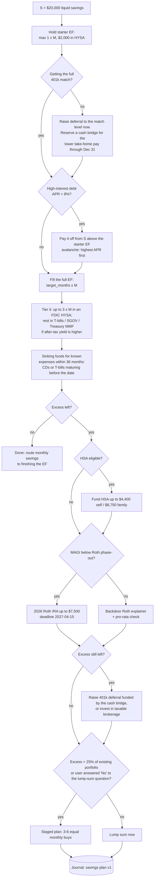

### 2.2 Step-by-step with the evidence behind each step

| Step | Action | Rule / evidence |
|---|---|---|
| 0 | Keep a **starter EF** of max(1 × M, $2,000) in an FDIC HYSA | Even $250-$749 of savings is associated with lower hardship (McKernan et al. 2016, correlational) [SA §2.1, §3.1]. Prevents new card debt while working down the list |
| 1 | **Capture the full 401(k) match** | 50-100% instant return. 36% of eligible employees leave about 1.6% of salary on the table (Choi, Laibson & Madrian 2011) [SA §2.1]. Check vesting first [SA §3.1]. This is a payroll change, so it usually needs only a small "match bridge" from savings |
| 2 | **Pay off APR > 8% debt** | A guaranteed return equal to the APR (Whiteboard: "a guaranteed return") [SA §3.1; CR-A §3.3]. Graham Stephan's order also puts the match first, then debt > 7-8% [CR-A §4.2]; Whiteboard puts debt before the match. The app shows both orderings when the debt is small [AE §11] |
| 3 | **Full EF** = clamp(3.0 + adjustments, 3, 12) × M | BLS: median unemployment spell ≈ 2.7 months, mean ≈ 6.2 months [SA §2.1]. Creator markers shown side by side: Jikh 3-6×, Tilbury 5× ("cautious") [CR-B §6.4]. "3-6 months" is a convention, not a precise research result [AE §11] |
| 3a | **Tier the EF** | Tier 2 = HYSA up to 3 × M. Tier 3 = T-bills/SGOV/Treasury MMF when `after_tax_Tbill > after_tax_HYSA + 0.10%`. I bonds can never count toward the EF until held 12 months [SA §1.8, §4.3] |
| 4 | **Sinking funds** for known expenses ≤ 36 months | CDs or T-bills maturing before the date; never equities [SA §1.8, §4.6] |
| 5 | **HSA** if eligible | Triple tax advantage; CA/NJ don't follow federal treatment [SA §3.1] |
| 6 | **2026 Roth IRA** ($7,500) | Room is use-it-or-lose-it; 2026 contributions are allowed until 2027-04-15, and 2027 room opens on 2027-01-01 [SA §3.2]. Roth contribution basis is a secondary liquidity backstop [AE §11; SA §3.1] |
| 7 | **More 401(k), then taxable** | "Taxable accounts are the last stop" (Whiteboard) [CR-A §3.3] |
| 8 | **Deploy**: lump sum vs. staged | Lump sum beats staged about two-thirds of the time (Vanguard 2012) [AE §10]. For a moderate user, stage over 3-6 months if the excess is > 25% of the existing portfolio [SA §4.4] |

### 2.3 Worked example (defaults: single, renter, stable W-2 job, no card debt, match already captured, not HSA-eligible)
target_months = 3.0 + 1.0 (single income) + 0.5 (macro overlay) = **4.5** [SA §4.5]. This is the default (`lean_conservative` off). If big drawdowns or job worries would keep you up at night, switch on "lean conservative" in `0_Profile`: the target becomes 6 months ($18,000 at M = $3,000) and the investable excess falls from about $6,500 to $2,000 (SPEC §10.1).

| M (essentials/month) | EF target | HYSA tier | T-bill tier | Investable excess | Suggested destination |
|---|---|---|---|---|---|
| $2,500 | $11,250 | $7,500 | $3,750 | ~$8,750 (or $7,250 with a $1,500 sinking fund) | $7,500 to the 2026 Roth IRA; the rest to the 2027 IRA in January or to taxable |
| $3,000 | $13,500 | $9,000 | $4,500 | ~$6,500 | 2026 Roth IRA |
| $3,500 | $15,750 | $10,500 | $5,250 | ~$4,250 (or $2,750 with a sinking fund) | 2026 Roth IRA |
| $4,500 | $20,250 | $13,500 | $6,500 | $0 (EF is $250 short) | Finish the EF from monthly savings |

Sensitivity: each $500/month change in M moves the excess by $2,250 [SA §4.5].

### 2.4 Picking the cash vehicles (sub-flow)
1. **Rank HYSAs by base APY, not promo APY.** Flag promos, minimums, deposit requirements, and residency restrictions [SA §1.2]. Benchmark against the 3-month T-bill (Treasury CSV or FRED `DGS3MO`, **not** the discount-basis `DTB3`) [TS §1.3]. As of 2026-11-10 the 13-week bill yielded 4.22% and the FDIC national average savings rate was 0.38% [SA §0; MC §10].
2. **Verify insurance.** The bank must be on FDIC BankFind or NCUA, with the account held directly in your name. Crypto "yield" accounts are not HYSAs (Jikh: BlockFi/Voyager) [CR-B §2.4]. Fintech middleware failures are not covered (Synapse 2024) [SA §1.2].
3. **Compute after-tax yield** with the TEY formulas [SA §1.4]. Example: a 4.22% T-bill is worth 4.79% HYSA-equivalent in California at 22% federal + 9.3% state.
4. **Switching rule:** only switch banks for about 1 percentage point or more, net of fees (Jikh's break-even model) [CR-B §2.4].
4a. **Know the tax bill on interest (SPEC FR-221).** HYSA, CD and most MMF interest is ordinary income, federal and state; T-bill and I bond interest is federal-only. Example: $20,000 at 4.0% earns about $800 a year, which costs about $176 of federal tax at 22% (plus state tax for a HYSA). Banks send a 1099-INT (T-bills too); MMFs and SGOV/BIL send a 1099-DIV. Interest under $10 is still taxable even without a form. If total interest and other non-wage income is large, raise W-4 withholding slightly rather than owe a penalty.
5. **Affiliate caution:** creator "favorite HYSA" pages are affiliate links (Whiteboard, Graham, Tilbury). The app shows them as `product_mention` with a conflict badge and never ranks by them [CR-A §3.5; CR-B §1.6].
6. **I bonds** (5.51% composite / 1.40% fixed for Nov 2026-Apr 2027) are attractive for the *non-emergency* cash beyond 12 months of need, up to $10K per person per year [SA §1.6; MC §10].

### 2.5 Choosing what to buy with the investable excess
- **Roth IRA:** follow the IPS core. The app proposes a 2- or 3-fund mix (total US + total international, plus bonds if bonds aren't already held in the 401(k)), drawn from the user's ETF universe and scored with the ETF flow (§5). If an optional factor sleeve is enabled, the highest-expected-return assets (e.g., small-cap value) go in the Roth/HSA first [SA §3.5].
- **Taxable:** broad US and international index ETFs (the foreign tax credit is usable there). Avoid high-yield and REIT funds there [SA §3.5; AE §5.1].
- **Under ~$50K invested:** hold the same mix in every account; location tweaks only when they save > 0.1%/yr [SA §3.5].
- **Output:** a printable "Savings Plan v1" with exact dollar amounts per account and vehicle, the as-of date of each rate, and a dated journal entry.

**Exit criteria:** EF funded and tiered; match captured; IRA contribution scheduled; any staged-buy schedule loaded into the monthly inbox.


---

## 3. Monthly routine (about 30 minutes, first weekend after payday)

**Trigger:** the `Home` inbox shows "Monthly review due". Before you start, run the data refresh job: `python -m fintec.jobs refresh prices macro feeds` [TS §5.1, §5.3].

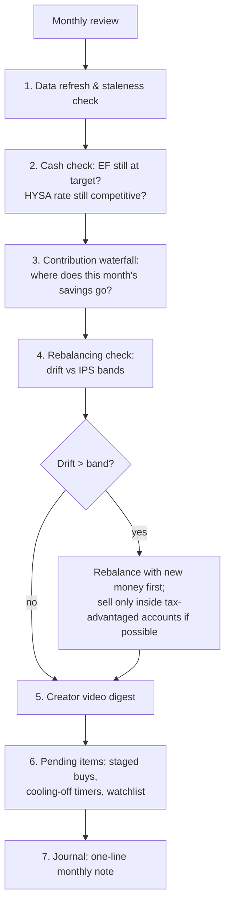

### 3.1 Data refresh and staleness check
- The `Home` page lists stale items: rates older than 7 days on the savings page, prices older than 1 trading day, `.info` older than 7 days [SA §4.6; TS §5.4].
- If a source failed, the app keeps serving cached data with a yellow "stale since X" badge. Never act on a red (stale) number. Click "verify at source" instead [TS §5.4, §6].

### 3.2 Cash check
- **EF level vs. target.** If you made a withdrawal, apply Tilbury's "replacement promise": refill it first, before investing [CR-B §1.4].
- **Rate check.** Warn if your HYSA APY is under 3.0% while top-tier APYs are 4%+ [SA §4.6]. Re-run the after-tax comparison if the 3-month T-bill moved more than 0.25 pp.
- **Excess cash alert** (`EXCESS_CASH_ALERT`): if cash > EF target + sinking funds + one month of buffer, the excess goes into the waterfall below. Felix: cash is for liquidity, not growth [CR-A §1.2]. Real after-tax HYSA yield is roughly zero at 3.7% CPI [CR-A §6.1; SA §0].

### 3.3 Contribution waterfall (`2_Account_Order_of_Operations` → Waterfall)
The app takes this month's surplus (take-home pay − spending) and allocates it with `MONEY_WATERFALL` [CR-A §7.5; SA §3.1]:

| Order | Bucket | Monthly check |
|---|---|---|
| 1 | Starter EF (if ever below) | Refill first |
| 2 | 401(k) match | Is the deferral still at least at the match level? Payroll changes and raises can break this |
| 3 | High-interest debt | Any new card balance carried? Pay it off |
| 4 | Full EF / sinking funds | Top up toward target |
| 5 | HSA | On track to the annual max? |
| 6 | IRA | Pro-rate: $7,500 / 12 ≈ $625/month, or lump-sum in January |
| 7 | 401(k) above the match | On pace for $24,500? Payroll deferrals must happen by Dec 31 [SA §3.2] |
| 8 | Taxable brokerage | Remaining surplus |

**Budget sanity check (optional):** the app shows your split against Tilbury's 25/15/50/10 and Whiteboard's 70/20/10. Both are labeled heuristics ("B/C" evidence), not targets [CR-B §1.2; CR-A §3.4].

**What to buy with each contribution.** Direct every new dollar to the most *underweight* asset class in the IPS ("rebalance with cash flows"). Payroll contributions always go in immediately; there is no market-timing logic [AE §10].

### 3.4 Rebalancing check
The app computes current vs. target weights across **all** accounts combined:
- Asset classes: US equity, ex-US equity, bonds, factor sleeve, stock satellite, thematic, crypto.
- **Bands (IPS default):** act when a class is more than 5 pp away from target in absolute terms, or more than 25% away in relative terms. This is a convention, so the app labels it that way.
- **Order of fixes:**
  1. Redirect new contributions.
  2. Rebalance inside the 401(k)/IRA (no tax).
  3. Only then sell in taxable, and only after the app shows the realized gain and tax estimate.
- **Guardrail checks that run every month** [AE §12; MC §7.4-7.5]:
  - single stock > 5% / > 10% of investable assets
  - stock satellite > 20% of equities
  - ex-US < 20% of equities ("home bias" flag)
  - factor tilt > 30%
  - thematic > 5%
  - crypto > 5%
  - **look-through concentration:** effective weight in the top 10 US stocks and in AI-linked industries across all your ETFs, plus overlap between your individual stocks and your ETFs. Warn if any single name's look-through exposure exceeds 10%, or AI-linked exposure exceeds 1.5× its market weight [MC §2.2; AE §7.1]
- **Turnover tracker:** warn if logged trades imply > 50% annual turnover [AE §6.1].

### 3.5 Creator video digest (`6_What_Experts_Say` → Digest)
The weekly RSS poller has already pulled new uploads from the 8 allowlisted channel IDs (plus Rational Reminder) and tagged their topics [TS §3.1, §3.5]. Your job is to triage, not to watch everything.

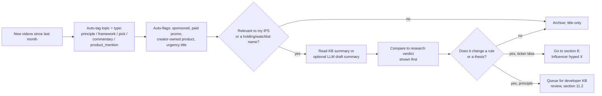

How to read the digest:
- **The research verdict comes first**, then each creator's stance side by side, sorted by trust weight [CR-B §6.1 rule 7]. Trust weights (SPEC §10.5): Felix 0.90, Plain Bagel 0.85, Carlin 0.60, Carlson 0.60, Graham 0.55, Jikh 0.55, Whiteboard 0.50, Tilbury 0.50. The first four from [CR-A §5]; the [CR-B] four are editorial proposals (their briefs give per-principle evidence ratings in [CR-B §1.7, §2.6, §3.7, §4.7], not numeric weights) and are re-confirmed at each KB review. Weights only order the display and weight the consensus view; they never enter a security score.
- **What each creator is best used for** in this app [CR-A §5; CR-B §5]:

  | Creator | Best use | Treat with caution |
  |---|---|---|
  | Ben Felix | Portfolio construction, factors, dividend/covered-call myths | Canadian accounts; PWL/DFA business interest |
  | The Plain Bagel | How to research a stock; finfluencer red flags; AI-advice caution | No picks by policy, so never encode a "Bagel buy" |
  | Whiteboard Finance | Order of operations, fee drag | Income/covered-call enthusiasm (D/E); **paid GRML promo Oct 2026**; heavy financial sponsors |
  | Graham Stephan | HYSA/T-bill motivation, "survive a lost decade" diversification | Urgent macro titles; FTX/Yotta history; sponsors |
  | Mark Tilbury | Beginner budgeting, 3-fund core, EF rules | UK products (ISA; IWDA is a PFIC problem for US persons); affiliate links |
  | Andrei Jikh | HYSA break-even math, FDIC checklist, "dividends vs. index" honesty | 2026 macro/geopolitics content = commentary only; crypto |
  | Sven Carlin | Valuation discipline, owner-earnings DCF, risk-as-permanent-loss | Persistent bear forecasts; extreme concentration; $499/yr platform |
  | Joseph Carlson | Moat/quality checklist, low turnover, behavior in panics | Outperformance claims (D); ~14 mega-cap names overlap your index; Qualtrim |

- **Macro and urgency titles** ("Urgent Warning", "Nightmare Scenario", "BREAKING") are tagged `commentary`, expire after 60 days, and never trigger an action [CR-A §4.7; CR-B §2.2].
- **Optional LLM:** if enabled, it drafts a 5-bullet summary with timestamps, labeled "LLM draft, unreviewed". It never adds numbers [TS §4].

### 3.6 Pending items
- Execute any **staged-buy tranche** due this month (from §2).
- **Cooling-off timers** that have expired: go back to the stock checklist (§6.8).
- **Watchlist:** names that hit your pre-set "price ≤ worst-case intrinsic value" trigger (§6.4). A trigger opens the checklist; it never buys automatically.

### 3.7 Monthly journal note
One line: what you did, what you didn't do, and how you felt about markets (1-5). Over time this feeds your **personal behavior gap**: dollar-weighted vs. time-weighted return [AE §6.2].

---

## 4. Quarterly routine (about 60-90 minutes; January, April, July, October)

**Trigger:** "Quarterly review due" in the inbox, ideally after the quarter's earnings season and the J.P. Morgan *Guide to the Markets* update [MC §9.2].

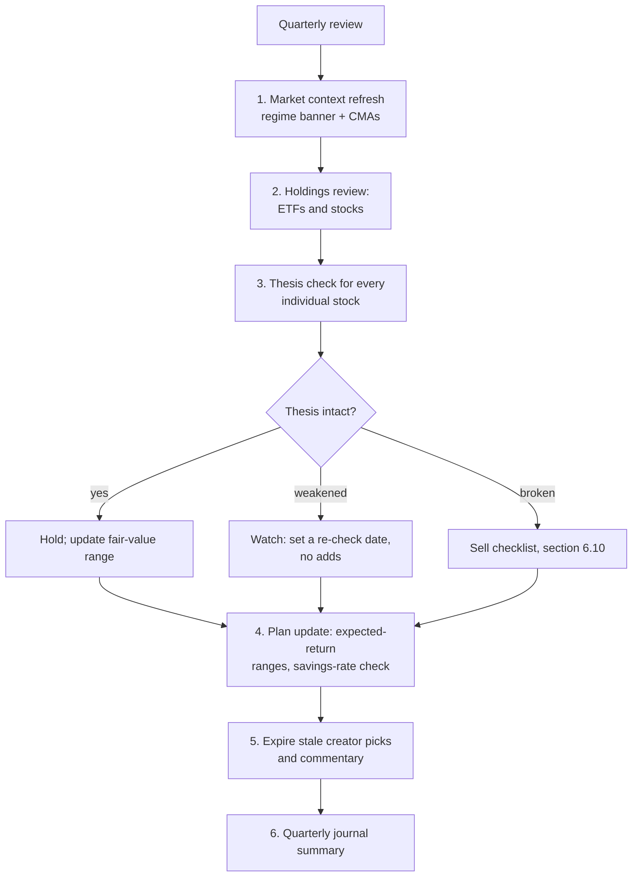

### 4.1 Market context refresh (`Home` → Regime banner; detail on `8_Market_Context`)
- The automated "R" series are already live: Treasury yields, TIPS real yield, breakevens, fed funds, CPI/PCE, unemployment, HY spread, oil [MC §9.1].
- **Manual "L" sources** whose cadence has elapsed: FactSet *Earnings Insight*, JPM GTM (quarterly), Vanguard VEMO (quarterly), BlackRock CMAs. The developer or user updates `knowledge_base/market/cma.json` and `knowledge_base/market/snapshot_manual.json` [MC §9.2-9.3].
- **The banner is descriptive.** It shows forward P/E, CAPE, 10-yr real yield, CPI y/y, fed funds, and HY OAS, each with its historical percentile. Nov 2026 snapshot: forward P/E 17.7×, CAPE 39.7, 10-yr TIPS 2.66%, CPI ≈ 3.7%, fed funds 3.75-4.00%, HY OAS 3.34% [MC §0].
- **What changes because of it:** only the *expected-return ranges* in the planner and the savings-vs-invest framing. With CAPE high, the message is "lower expected returns, so save more and diversify internationally", never "get out" [AE §8.2].
- **CPI note:** BLS cannot publish 12-month changes for October 2026 because of the 2025 shutdown gap. The app shows "n/a" or a labeled estimate [MC §3.3].

### 4.2 Plan update
- The planner's "consensus band" is the min-max across institutional CMAs. Example: Vanguard US equity 4.8-6.8%, ex-US developed 5.3-7.3%, US Agg 5.1-6.1%; JPM US large cap 7.5% [MC §8]. **The moderate-user default is the conservative end.** Do not plan with the trailing ~15% 10-yr S&P return, or the 10% nominal figures common in creator examples (Tilbury, Whiteboard) [MC §1.2; CR-B §1.7; CR-A §3.8].
- Historical factor premiums are haircut 50% for planning (`factor_premium_haircut = 0.5`) [AE §4.1].
- **Savings-rate check:** if the projected retirement outcome falls short at the conservative band, the fix offered is "raise savings or extend the horizon", not "take more risk" [AE §8.2].

### 4.3 Holdings review
**For each ETF:**
- Re-score it with the ETF scorecard (§5). Flag it if its expense ratio rose, its tracking difference worsened, or its AUM fell sharply.
- Is there a cheaper equivalent? Run the fee-drag calculator (`FEE_DRAG_CALC`) [AE §1.5].
- Re-run the factor regression on rolling 36-60 months. Does a "value" or "quality" fund still deliver its stated loadings? [AE §3.1; TS §5.2]

**For the whole portfolio:**
- Look-through concentration (top 10 and AI-linked).
- Overlap between individual stocks and ETFs. Example: holding AAPL plus VOO raises AAPL concentration [AE §7.1].
- Satellite size vs. IPS.
- **Active-share check** on your stock satellite vs. SPY/QQQ (the critique raised against Carlson's portfolio). If the satellite is a "closet index" with high overlap, it adds risk and effort without diversification [CR-B §4.6].

### 4.4 Thesis check for every individual stock
Open the journal entry for each stock and answer these questions:
1. **Are the original thesis drivers still true?** Check moat, revenue growth, margins, balance sheet, and capital allocation against the latest 10-Q from EDGAR [TS §1.2].
2. **Have any pre-written "thesis-break" conditions triggered?** These were written at purchase (§6.7). Examples: "gross margin below X for 2 quarters", "net debt/EBITDA above 3×", "loses #1 market share".
3. **Scorecard drift:** did the quality or value sub-score drop by more than 1 decile?
4. **Valuation:** update the three-scenario intrinsic value (§6.4). Is the price above the best case (stretched) or below the worst case (opportunity)?
5. **Position size:** still within the 5% cap after price moves?
6. **Disposition-effect prompt:** *"Would you buy this today at this price?"* The app shows the thesis **next to** P/L, never P/L alone [AE §6.3].

Verdicts: **Intact** (hold; adds allowed within caps), **Weakened** (no adds; re-check next quarter), **Broken** (go to the sell checklist in §6.10).

### 4.5 Expire stale KB items
Creator picks older than 120 days and commentary older than 60 days are hidden from the "mentioned by" panels and get a "stale" badge [CR-B §6.1]. Positions older than 365 days are hidden from buy logic [CR-A §7.1].

### 4.6 Quarterly journal summary
The app auto-fills: trades this quarter, turnover, satellite vs. core return (time-weighted), your personal behavior gap, and rule overrides (how many times you overrode a warning, and why). You write 3 sentences on what you learned.

---

## 5. Flow: "Evaluate an ETF"

**Page:** `3_ETF_Explorer`. **Use it when** you are picking the core funds, comparing two similar funds, adding a factor/dividend/thematic fund, or reviewing a creator-mentioned fund.

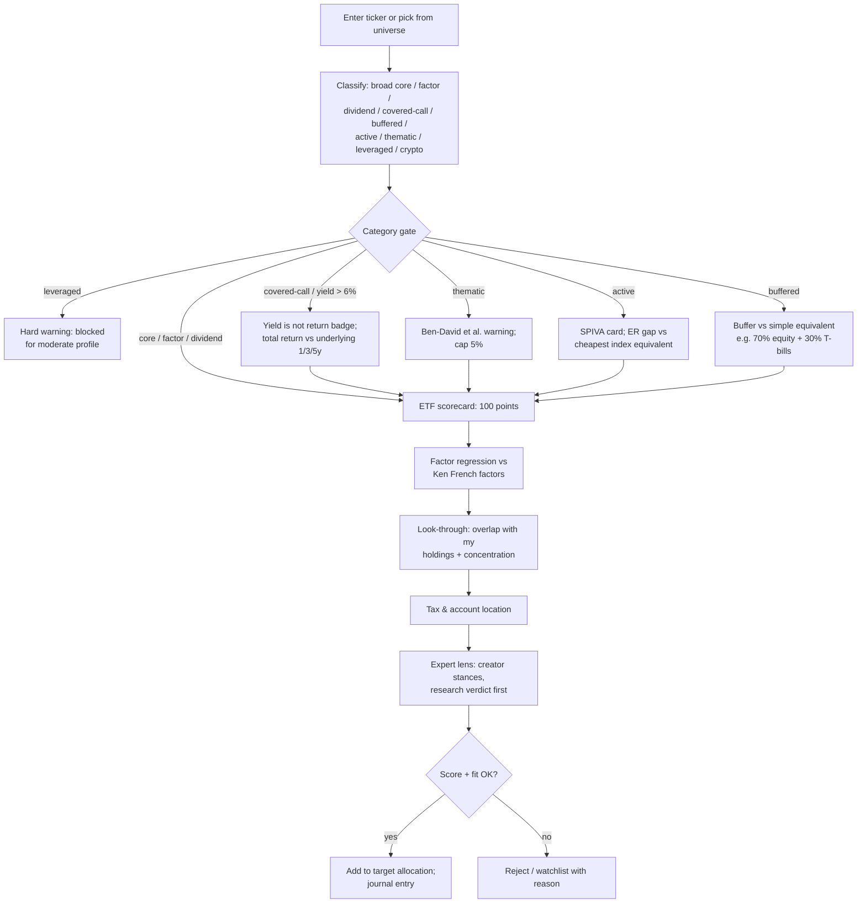

### 5.1 Scorecard (default weights from [AE §6.4, §12])
These weights are design choices informed by the research, not estimates taken from it.

| Component | Weight | Measure | Evidence |
|---|---|---|---|
| Expense ratio | **30** | Rank vs. comparable funds; lower is better, monotone | Carhart 1997; Kinnel 2016; Sharpe 1991 [AE §1.4, §6.4] |
| Factor / goal fit | 20 | Do the regression loadings match the stated goal (e.g., HML/RMW > 0 for "value/quality")? | Fama-French 2015; Novy-Marx 2013 [AE §3] |
| Tracking difference | 15 | Fund total return minus index total return, multi-year | [AE §12] |
| Diversification | 15 | Holdings count, top-10 weight, sector/country concentration | [AE §7.1; MC §2] |
| Liquidity / spread | 10 | AUM, average spread | [AE §12] |
| Tax efficiency | 10 | Capital-gain distribution history, yield drag in taxable | [AE §5.1; SA §3.5] |

**Never scored:** trailing 1-3-year return. The app warns if you sort by it [AE §1.4]. Yield is never a sort key [MC §7.1].

### 5.2 Factor regression
- FF5 + momentum with Newey-West HAC errors. Requires at least 36 months, and shows `n_months`, R², and 95% CIs [TS §5.2].
- Use US factors for US funds and `Developed_ex_US` or `Emerging` factors for international funds [TS §1.10].
- **Read it like this:**
  - A broad index fund should show Mkt ≈ 1.0, SMB ≈ 0, HML ≈ 0, R² > 0.95.
  - A small-cap value fund should show SMB > 0, HML > 0, and ideally RMW > 0. Avantis and Dimensional screen for profitability, which matters because about 38% of Russell 2000 companies are unprofitable [MC §5.1].
  - For a dividend ETF, how much of its return is just value + profitability + investment exposure? (Dividend effect subsumed by factors) [AE §5.1; CR-B §2.6].
- **Alpha:** shown with the "could be luck" calculation. t ≈ (alpha / tracking error) × √years [AE §1.3].

### 5.3 Category-specific gates
| Category | What the app shows | Default stance for this user |
|---|---|---|
| Broad core (VTI/VOO/VXUS/total-world, or 401(k) index funds) | Scorecard only | **Preferred core** (consensus of Felix, Graham, Tilbury, Jikh, Whiteboard) [CR-A §5; CR-B §5] |
| Factor tilt (e.g., AVUV, AVDV, DFAC, QUAL, VLUE) | Papers; expected premium net of fees after a 50% haircut; longest underperformance stretch; tracking-error tolerance question | Optional, 0-30% of equities, sized to survive a decade of lagging [MC §5.2; AE §3.1] |
| Dividend growth (SCHD, VIG, DGRO) | Total return, factor decomposition, tax drag in taxable, "free dividends?" explainer | Allowed as a quality/value tilt, never justified as "income is free"; prefer IRA location [AE §5.2] |
| Covered-call / option-income (JEPI, JEPQ, QYLD, YieldMax-type) | Total return vs. underlying (5-yr: JEPI 7.63% vs. SPY 11.40%); upside-cap illustration; ordinary-income tax note | "Not aligned with accumulation goal"; red warning for single-stock option-income [MC §7.1]. Felix vs. Whiteboard disagreement shown [CR-A §5] |
| Buffered / defined-outcome | Remaining cap/buffer for the current outcome period; simple-equivalent comparison; mid-period entry warning | Usually dominated by a lower equity share plus T-bills [MC §7.2] |
| Active ETF | SPIVA category figure; ER gap; 10-yr compounded cost on $10K | Penalized unless ≥ 10 years of net outperformance [AE §1.2; MC §7.3] |
| Thematic (AI, defense, etc.) | Ben-David et al. 2023: specialized ETFs lose ~30% risk-adjusted in their first 5 years; overlap with holdings; "behavior-gap risk: high" badge | ≤ 5% of portfolio [MC §7.4; AE §6.2] |
| Equal-weight (RSP) | Higher ER (0.20% vs. 0.03% [UNVERIFIED current figures]), turnover, size/value tilt | Neutral diversifier option against concentration [MC §2.2; CR-B §1.7] |
| Leveraged (UPRO, TQQQ) | Volatility decay, cherry-picked backtests | **Blocked for moderate profile** (`BLOCK_LEVERAGED_FOR_MODERATE`) [AE §9; CR-A §1.2] |
| Crypto (IBIT) | Max drawdown; no cash flows | Speculative satellite; default 0%, opt-in ≤ 5% [MC §7.5] |
| UCITS/foreign-domiciled (IWDA, IBTM) | PFIC warning for US persons | Use US-domiciled equivalents [CR-B §1.6] |

### 5.4 Look-through and location
- **Overlap:** for example, VTI + QQQ + a tech ETF can push look-through Nvidia/Microsoft/Apple exposure above 20% [MC §2.2].
- **Location:** bonds/TIPS/REITs go in the 401(k)/IRA; small-cap value/factor in the Roth/HSA; broad US and international in taxable (foreign tax credit) [SA §3.5].
- **Fidelity ZERO funds** can only be held at Fidelity. Validate tickers and expense ratios against live data, never against creator descriptions (e.g., Graham's "FXIAX" typo for FXAIX) [CR-A §4.3].

### 5.5 Output
A one-page ETF report: score, regression, gates triggered, location, creator stances, and a "verify at issuer" link for the expense ratio. If you add the fund, the journal entry records **role in the IPS** (core / tilt / diversifier) and **what would make you replace it** (ER undercut by > 0.05 pp, tracking difference worsening, strategy drift).

---

## 6. Flow: "Evaluate a stock as a buy candidate"

**Page:** `5_Stock_Research`. **Scope:** this is the **satellite** sleeve only. A persistent banner reads: *"On average, active selection underperforms the index after costs (Sharpe 1991). Historically, most individual stocks underperformed T-bills over their lifetime; ~4% created all net wealth (Bessembinder 2018). Treat picks as a satellite allocation."* [AE §1.1, §2.1]

### 6.0 Overview

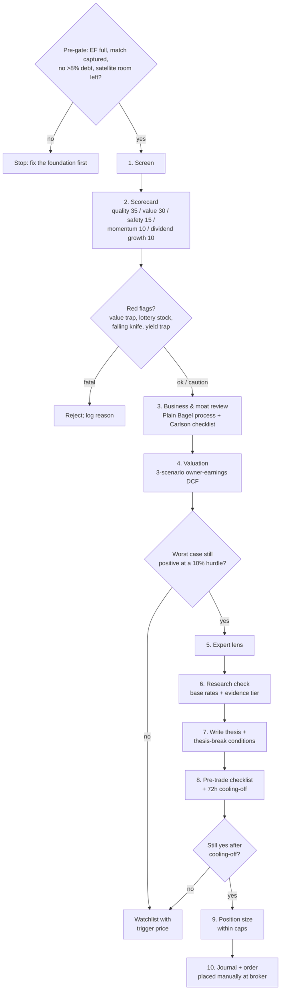

**Pre-gate.** The app refuses to open the checklist until:
- the EF is at target,
- the match is captured,
- no APR > 8% debt remains, and
- the satellite is below its IPS cap.

Carlin: "only invest money you don't need", "first solve your life" [CR-B §3.4].

### 6.1 Step 1: Screen
- **Universe:** US filers with EDGAR XBRL data (EDGAR is the source of truth for fundamentals) [TS §1.2]. Exclude microcaps below a market-cap floor (default $2B). Exclude stocks with fewer than 5 years of filings.
- **Presets** matching the user's interests:

  | Preset | Filters (defaults, user-adjustable) | Basis |
  |---|---|---|
  | Quality-value | GP/Assets top 40%, ROE > 15%, net debt/EBITDA < 2, EV/EBIT below sector median | Novy-Marx 2013; QMJ [AE §3.3-3.4] |
  | Dividend growth | ≥ 10 years of dividend growth, FCF payout < 70%, yield < 2× sector median | Quality screen, not "income" [AE §5.1-5.2] |
  | Quality growth / "compounders" | 5-yr revenue CAGR > 10% organic, gross margin > 40%, positive FCF, low leverage | Carlson's framework [CR-B §4.2] |
  | Deep value (Carlin-style) | P/E < 12, P/B < 1.5, ROE > 12%, positive owner earnings | Carlin's profile [CR-B §3.2]; LSV 1994 |
- **Multiple-testing warning:** if you change filters repeatedly, the app counts the variants and shows: *"You tested N variants; the best result is expected to look good by chance"* (Harvey, Liu & Zhu 2016) [AE §4.3].

### 6.2 Step 2: Scorecard (default weights from [AE §12])
| Block | Weight | Components |
|---|---|---|
| Quality (QMJ-style) | **35** | Profitability: GP/A (at least 25% of the block), ROE, ROA, margins. Growth: 5-yr change in profitability. Payout: net buybacks + dividends |
| Value (cross-sectional) | **30** | EV/EBIT, FCF yield, P/E, P/B vs. sector peers. Cross-sectional comparison, **not** a market-timing tool [AE §8.2] |
| Balance-sheet safety | **15** | Leverage, interest coverage, earnings volatility, beta |
| Momentum (12-1 month) | **10** | Minor secondary score; mostly a falling-knife flag [AE §3.2] |
| Dividend-growth consistency | **10** | Optional; reassign to quality if you don't want dividends |

Only `canonical` evidence-tier signals may carry more than 10% weight [AE §4.2].

**Red flags (automatic):**
- **Value trap:** cheap (value percentile ≥ 70) and weak (GP/A percentile ≤ 30, negative FCF or a TTM loss) [AE §3.3].
- **Lottery stock:** top decile of idiosyncratic volatility [AE §3.5].
- **Falling knife:** very negative 12-1 momentum on a "cheap" stock [AE §3.2].
- **Yield trap:** warning when yield > 2× sector median **or** EPS payout > 80% **or** FCF payout > 100% [MC §6]; blocking when yield > 2× sector median **and** FCF payout > 100% [AE §5.1]. Full flag list and thresholds: SPEC §10.3.4.
- **Data discrepancy:** EDGAR vs. provider values differ by more than a threshold [TS §1.13].
- **Paid promotion:** the ticker appears in any `paid_promotion: true` record (e.g., GRML) or the Plain Bagel promoted-stock list. This sends you straight to §8 [CR-A §2.2, §3.6].

### 6.3 Step 3: Business and moat review (structured notes, about 30-60 minutes)
Plain Bagel's process: screen → understand the business → finances → strategy → valuation → written notes [CR-A §2.4]. The app gives one form section per step, pre-filled with EDGAR data. Carlson's moat questions are required fields, answered Yes / No / Unsure [CR-B §4.2]:
1. High barriers to entry?
2. Majority or leading market share?
3. Entrenched brand and distribution?
4. Sits "on top of the food chain" (pricing power over suppliers and customers)?
5. Heavy reliance on high-risk R&D? (a "yes" is a negative)
6. Growth only through acquisitions? (a "yes" is a negative)
7. High leverage? (a "yes" is a negative)
8. Would it survive a bad recession?

Rule: "Unsure" on three or more questions puts the stock on Carlin's **"too hard pile"**, and the flow stops there [CR-B §3.2].

### 6.4 Step 4: Valuation (Carlin's intrinsic-value method; `carlin.valuation.001`)
- **Owner earnings/share** = operating cash flow − capex − stock-based compensation (from EDGAR).
- **Two-stage growth:**
  - Years 1-5 at the 5-year revenue CAGR, capped at 15% (user-editable).
  - Years 6-10 at the sector average (default 5%).
  - Terminal value = year-10 owner earnings × a terminal multiple (default 15; worst case 10, best case 20). SPEC §10.3.6 has the exact formula.
- **Fixed 10% discount rate** ("a value investor's minimum required return") [CR-B §3.2]. The app also shows the result at 8% and 12%, because the hurdle choice drives the conclusion (evidence rating B) [CR-B §3.7].
- **Three scenarios** (worst / normal / best; default weights 0.3 / 0.4 / 0.3) give a probability-weighted value and a range.
- **Buy-zone rule:** the stock is a *candidate* only if the **worst case is still positive** at the current price, meaning price ≤ worst-case value or expected return ≥ 10% even in the worst case. Otherwise it goes to the watchlist with a trigger price.
- **Cross-check:** Carlson's DCF + moat-premium approach is shown as an alternative, labeled "judgment adjustment; no mathematical formula" [CR-B §4.2].
- **Sanity checks:**
  - The implied growth rate in today's price (a reverse DCF).
  - Comparison to the stock's own 10-yr multiple range.
  - The market's forward P/E context (17.7× on 2026-11-05) [MC §1.1].

### 6.5 Step 5: Expert lens (`6_What_Experts_Say` panel embedded)
- **"Mentioned by" panel:** dated creator picks/positions for this ticker, with stance, date, `sponsored`, `paid_promotion`, `self_reported`, and staleness. Example: Carlson's 2026-11-02 fair values (expires 2027-03-02) [CR-B §6.3].
- **Principles that apply:** for example, Felix's single-stock-risk principle [CR-A §7.3], Carlson's "individuals can outperform" (rated D) [CR-B §4.7], and Graham's "stock tips are gambling" [CR-A §4.1].
- **Wall Street view** (optional, Finnhub free tier): analyst recommendation trends and earnings surprises, labeled "provider estimate" [TS §1.5].
- **Rule:** the expert lens can lower conviction (any conflict flag, or disagreement among high-trust sources), but it can **never raise the score** [CR-A §7.1].

### 6.6 Step 6: Research check (`7_Research_Library` cards, auto-attached)
The app attaches the relevant evidence and its tier:
- **Base rate card:** Bessembinder 2018 / BCCW 2023: 55-57% of stocks trail T-bills over their lifetime [AE §2.1].
- **Diversification card:** at least 30 stocks across at least 8 sectors before a stock-only portfolio counts as "diversified" (Statman; Domian) [AE §7.1].
- **Evidence for your thesis type:** quality/profitability (moderate-strong), value (moderate-strong but cyclical), dividends (theory says irrelevant), momentum (strong pattern, hard to capture) [AE §12].
- **Your own record:** your satellite's time-weighted return vs. its benchmark since inception, and your hit rate. If your satellite has trailed the index for 3+ years, the app suggests shrinking the cap, not adding.

### 6.7 Step 7: Write the thesis (journal, required)
Required fields:
1. Why this business (3 sentences max).
2. Why now: what is the market missing? (Carlson: "misunderstood fear") [CR-B §4.2].
3. Valuation range and expected return.
4. **Thesis-break conditions:** 2-4 measurable conditions that would make you sell.
5. Holding period intent (Carlson: 5+ years) [CR-B §4.2].
6. Where the idea came from (a screen, a creator, a friend). This lets the app track your idea sources' hit rates.
7. Emotional state (1-5) and "Am I buying because the price went up?"

### 6.8 Step 8: Pre-trade checklist with cooling-off
The checklist only unlocks after the thesis is saved. A **72-hour timer** starts then (the 48-72 h range from [AE §6.1]; the user can set 48 h but not less). After the timer, every box must be ticked again. These are the 15 items of SPEC §10.8 in user language:

| # | Check | Source |
|---|---|---|
| 1 | Foundation OK: EF at target and no debt > 8% APR | [SA §3.1] |
| 2 | Full 401(k) match captured | [SA §2.1] |
| 3 | Caps hold after this buy: satellite ≤ 10% of equities (strong warn > 20%), single stock ≤ 5% (strong warn > 10%) including look-through ETF exposure, thematic ≤ 5%, crypto ≤ cap | [AE §2.1, §7.1; MC §2.2] |
| 4 | Money not needed within 5 years (Carlin: "only invest money you don't need") | [CR-B §3.4] |
| 5 | Thesis written: why, what must be true, risks, pre-mortem, thesis-break (exit) conditions | [AE §6.3] |
| 6 | Valuation done (DCF, reverse DCF) and margin of safety reviewed: worst case still positive at today's price | [CR-B §3.2] |
| 7 | Moat checklist completed | [CR-B §4.2] |
| 8 | Base-rate card acknowledged (Bessembinder) | [AE §2.1] |
| 9 | Overlap with my ETFs reviewed | [AE §7.1] |
| 10 | No paid-promotion or sponsored source behind the idea, and not driven by a single video or a recent price spike | [CR-A §2.2; AE §6.1] (Barber et al. 2022) |
| 11 | Account choice made (Roth IRA for highest expected growth, taxable if you want TLH flexibility) and wash-sale check passed in **every** account, including IRA and DRIP | [SA §3.5; AE §6.3; CR-B §2.5] |
| 12 | Cooling-off period elapsed | [AE §6.1] |
| 13 | "If this fell 30% next month, would I hold or buy more?" answered (and I re-read my IPS) | [AE §2.1] |
| 14 | Position size within IPS; amount entered | §6.9 |
| 15 | All inputs fresh: no red badges; amber values verified at the source | SPEC FR-109 |

If any box fails, the idea goes to the watchlist with the failing reason.

### 6.9 Step 9: Position sizing
- **Starter position:** default 1-2% of investable assets. Maximum at purchase: 3%, leaving room to add up to the 5% cap after the thesis proves itself (adds require a quarterly "Intact" verdict).
- **Optional conviction scaling:** size = base × (score percentile factor) × (1 − conflict penalty). It can never exceed the cap.
- **Skew simulation:** the app shows a bootstrapped single-stock outcome distribution (median vs. mean) for this position size, so you see the median-vs-mean gap [AE §2.1].
- **Staging:** optional 2-3 tranches for a moderate-risk user.

### 6.10 Step 10: Journal and execution; sell checklist
- You place the order manually at the broker. Use limit orders; avoid aggressive orders (Barber et al. 2009: most individual losses came from aggressive orders) [AE §6.1]. Then record the fill in the journal.
- **Sell checklist** (used from the quarterly thesis check, or whenever you want to sell):
  1. Which thesis-break condition triggered? If none, why sell?
  2. *"Would you buy this today at this price?"* [AE §6.3]
  3. Is this a reaction to a price drop alone? Carlin: a temporary price decline is not risk [CR-B §3.2].
  4. Tax: short vs. long term; can a loss be harvested? Wash-sale check across all accounts [AE §6.3].
  5. Where do proceeds go? Default: back to the most underweight core asset class.
  6. A 24-hour cooling-off applies to sells too, except when an objective thesis break is documented.

---

## 7. Flow: "The market is crashing"

**Trigger:** the S&P 500 or your portfolio is down 10%+ from its peak, or headlines/creator titles turn alarmist. The `Home` page detects drawdowns of −10%, −20%, and −30% from data it already has, and offers **"Open the crash playbook"**. It never shows a red "sell" banner.

**Why this flow exists:** the behavior gap of about 1.1-1.2 pp/yr is largest in volatile periods and narrow funds [AE §6.2]. Momentum crashes and panic states happen after declines [AE §3.2]. The user's own stated risk is that big drawdowns cause stress.

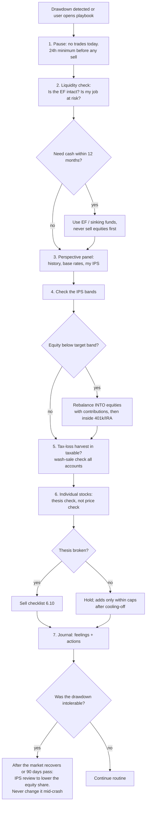

### 7.1 Step details
1. **Pause.** The app greys out the "sell" checklist for 24 hours after it opens. Contributions continue automatically. Payroll DCA is optimal [AE §10]; Graham Stephan: "Buy consistently… Ignore headlines" [CR-A §4.2].
2. **Liquidity check.** This is where the EF earns its keep. It is exactly why the EF is never held in stocks or bonds: 2022 hit both together, and job-loss risk rises in downturns [SA §4.3]. If job risk is high, temporarily move toward the top of the EF range by redirecting new savings, not by selling equities. **Do not touch the 401(k).** Withdrawals carry income tax plus a 10% penalty; at most there is a $1,000 SECURE 2.0 emergency distribution. Roth IRA *contributions* are the backstop, not the first layer [AE §11; SA §3.3a].
3. **Perspective panel** (pre-written KB content plus live numbers):
   - Current drawdown vs. historical drawdowns.
   - Graham's 2000-2009 "lost decade" example ($10K → about $9,089 with dividends) [CR-A §4.2].
   - Carlin: real drawdowns of about 60-70% in 1929-50s, 1968-82, and 2000-09 [CR-B §3.2].
   - **And** the counterpoint: CAPE does not time markets, and those who sat out lost heavily [AE §8.2].
   - Carlson: held through COVID and bought in the 2025 tariff panic [CR-B §4.2].
   - Felix: investing at all-time highs, and (by implication) during declines, is normal [CR-A §1.4].
   - Your IPS sentence written at setup: "I chose 80/20 knowing a 30% equity drop means about a 24% portfolio drop."
4. **IPS bands.** Falling equities often push equity below its band. Rebalancing means **buying** equities with bonds/cash inside tax-advantaged accounts. This is the mechanical, pre-committed contrarian action, and the only "buy the dip" action the app endorses.
5. **Tax-loss harvesting** (taxable only):
   - Sell the lot at a loss and buy a similar but not "substantially identical" fund (e.g., a different index provider). The VTI↔VOO swap is a gray area, not a certainty [CR-B §2.5].
   - Check purchases in **every** account for 30 days before and after, including IRA/Roth buys and dividend reinvestment. A matching IRA purchase makes the loss permanently disallowed (Rev. Rul. 2008-5) [AE §6.3].
6. **Individual stocks:** run the quarterly thesis check (§4.4) early. A price fall alone is not a thesis break [CR-B §3.2].
7. **Journal:** record feelings honestly. This becomes the evidence for the next IPS review.
8. **Never during a crash:** change the IPS, buy leveraged ETFs to "recover faster", move the EF into stocks, or act on an "Urgent Warning" video [AE §9; CR-A §4.7].

---

## 8. Flow: "An influencer just hyped X" (anti-FOMO)

**Trigger:** you watched a video, or saw a post, that made you want to buy something *now*. Open `6_What_Experts_Say` → **"I just saw a pitch"** and paste the URL or ticker.

**Evidence behind this flow:**
- Paid YouTube stock promotions pop about 7.9% on day 1 and 11.8% over 5 days, then revert within about 30 days (de Oliveira Leite et al. 2025, *Applied Economics Letters*) [CR-A §2.2].
- The Plain Bagel's review of 123 paid promotion videos found promoted microcaps typically collapsed afterward [CR-A §2.2].
- Attention-induced herding (Robinhood) is followed by negative returns (Barber et al. 2022) [AE §6.1].
- Thematic launches follow hot performance and then underperform [MC §7.4].

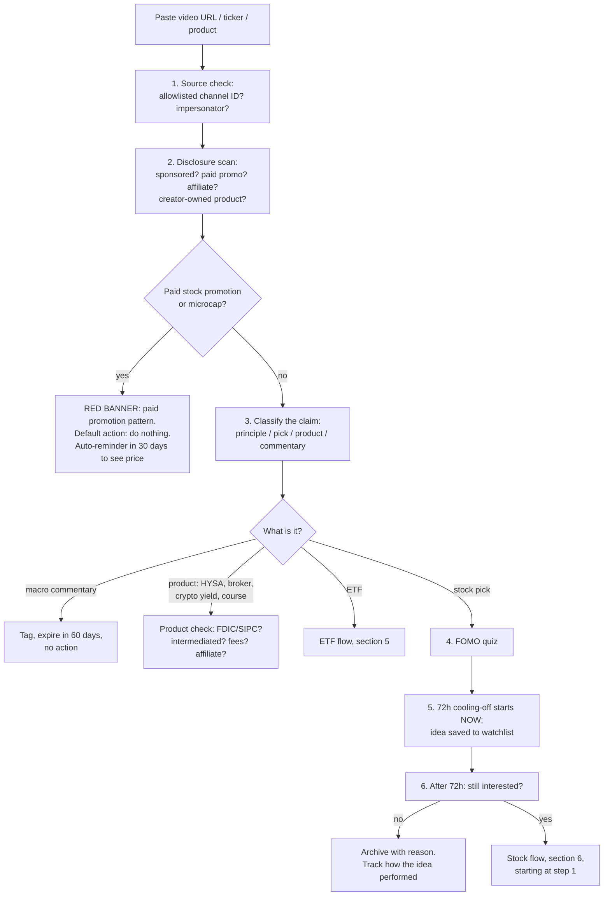

### 8.1 Step details
1. **Source check.** Is the channel ID on the allowlist? Sven Carlin has a known impersonator channel (`UC67NIxAks8wXAmGPoyY7r5A`). Never trust a channel from search results alone [TS §3.1].
2. **Disclosure scan.** The app parses the description for "compensated", "sponsored", "affiliate", promo codes, and referral links, and checks KB conflict records. Examples:
   - Whiteboard Finance's $5,000 paid GRML promotion (2026-10-18), with the description saying profiled securities "should be considered high risk" [CR-A §3.6].
   - Graham's FTX and Yotta history [CR-A §4.7].
   - Jikh's BlockFi/Voyager promotions [CR-B §2.5].
   - Carlin's $499/yr platform and Carlson's Qualtrim [CR-B §3.6, §4.6].
3. **Classify.** Picks are shown as dated "creator watchlist" items, never recommendations [CR-B §6.4]. Self-reported performance is labeled `self_reported: true` and unaudited. Examples: Carlin's 72× claim, Tilbury's income claims [CR-B §1.1, §3.5].
4. **FOMO quiz** (the answers are logged):
   - Did the price rise a lot in the last 30 days? If so, you may be seeing the promotion "pop".
   - Would I still want this if nobody else were talking about it?
   - What do I know that the market doesn't?
   - Does this fit my IPS satellite room? If not, stop.
   - What does the highest-trust source in the KB say? Example: Felix's single-stock risk; Plain Bagel's finfluencer red flags [CR-A §7.3].
   - How many times have I acted on a video idea, and how did those trades do? (The app shows your idea-source hit rate.)
5. **Cooling-off:** a mandatory 72 hours. The app sets a reminder.
6. **After cooling-off:** most ideas die here, which is the intended outcome. Survivors go through the full stock flow with no shortcuts.

### 8.2 Product-pitch sub-checks (HYSA, broker, crypto yield, courses)
- **"High-yield" from a non-bank or crypto platform is not a HYSA** (BlockFi, Voyager) [CR-B §2.4].
- Is the account directly at an FDIC/NCUA institution? Is the rate a promo? What does it pay after tax vs. a T-bill? [SA §1.2, §1.4]
- **Broker sign-up bonuses** ("free stock"): fine to take, but the decision should rest on fees, fund menu, and SIPC coverage.
- **Paid stock-pick platforms and courses:** check FINRA BrokerCheck and the creator's credential record in the KB [CR-A §2.2]. Self-reported track records are not evidence.

---

## 9. Yearly routine (November-January, about 2-3 hours, spread over a few sessions)

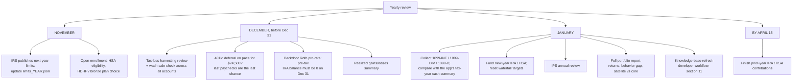

### 9.1 Tax-loss harvesting (December, taxable account only)
1. The app lists lots with unrealized losses above a threshold (default $500 or 5%).
2. For each lot it proposes a **replacement** that keeps the exposure but is not substantially identical (a different index provider). The app labels pairs it considers gray-area [CR-B §2.5].
3. **Wash-sale check:** purchases of the same or a substantially identical security in **any** account (taxable, IRA, Roth, 401(k) auto-buys, DRIP) within 30 days before or after the sale (61 days total). The IRA trap makes the loss permanently lost [AE §6.3]. The app suggests turning off DRIP and pausing scheduled buys in that fund for the window.
4. Harvested losses offset gains, then up to $3,000 of ordinary income per year; the rest carries forward. December reversal of the disposition effect is fine **when it's deliberate** [AE §6.3].
5. Journal the swap, with a reminder to swap back (optional) after 31 days.

### 9.2 Contribution limits update (November)
- When the IRS announces next-year limits (usually in November; not yet published for 2027 as of 2026-11-10), update `knowledge_base/accounts/limits_2027.json` (and `tax_brackets_2027.json`) with the source URL [SA §3.2; CR-A §6.1]. Never hard-code limits [AE §11].
- 2026 reference values:
  - 401(k) $24,500 (+$8,000 catch-up at 50+, $11,250 at ages 60-63)
  - §415(c) total $72,000
  - IRA $7,500
  - HSA $4,400 / $8,750
  - Roth phase-out $153K-$168K single
- **Re-check every year:** the Roth phase-out, the Traditional-IRA deduction phase-out, the 0% qualified-dividend bracket, and the HSA/HDHP thresholds. Also check for new SECURE 2.0 items, e.g., the Saver's Match from tax year 2027 [SA §3.3a].
- **Re-run the waterfall** for the new year: the monthly IRA amount, the 401(k) % needed to hit the max by December, and HSA payroll.
- **Roth vs. Traditional re-check** with the new brackets and any income change [SA §3.4].

### 9.3 IPS review (January)
Answer these questions, then re-sign the IPS:
1. Did anything change in life? (income, job stability, household, home purchase plans, dependents)
2. Re-run the risk questions. Compare with your crash-journal entries. If you sold or wanted to sell in a drawdown, lower the equity share by 10 pp. **Do this only in calm markets** [AE §6.2].
3. EF months: recompute with current adjustments, including the macro overlay [SA §2.2].
4. Satellite performance: has your stock sleeve beaten its benchmark on a time-weighted basis since inception? If not after 3+ years, shrink the satellite cap. Base rates say this is the likely outcome [AE §1.1, §2.1].
5. Factor tilt: still willing to tolerate tracking error? Felix's "Quant Winter" episode is the reference for long underperformance [CR-A §1.4].
6. Home bias: equity ex-US share vs. global cap weight; the app shows your deviation as an explicit bet [MC §4.2].
7. Glide path: at this age and horizon, should bonds rise by 0-5 pp? [AE §9]
8. Rule overrides: review every time you overrode a warning this year. Keep the rule or change it, and record the reason.

### 9.4 Annual report (auto-generated)
- Time-weighted and dollar-weighted returns per account; personal behavior gap [AE §6.2].
- Fees paid (expense ratios × balances) and the fee-drag trend [AE §1.5].
- Turnover; realized gains/losses; dividends received and the tax drag estimate [AE §5.2].
- Satellite vs. core; best/worst idea sources (screens vs. creators vs. other).
- Savings rate; EF months covered; progress to the planning targets at the conservative CMA band.

### 9.5 Knowledge base refresh (January, plus ad hoc)
See §11. The user-facing checkpoint is the `Home` page "KB health" card:
- last full refresh date
- count of [UNVERIFIED] items
- stale creator positions
- CMA ages
- papers whose DOI failed to resolve

The app nags once the full refresh is more than 12 months old.

---

## 10. The decision journal and user data files

Every flow above ends in the journal. It is the app's memory and the antidote to hindsight bias. The system of record is the local DuckDB file `data/fintec.duckdb` (git-ignored; SPEC FR-106, §7.1). The app writes human-readable exports to `data/user/` and reads imports from there [TS §5.3, §5.5]:

| Export / import (in `data/user/`) | Contents |
|---|---|
| `profile.json` (export) | Section 1 inputs (no account numbers or credentials) |
| `ips.md` (export) | Signed IPS with version history |
| `holdings_*.csv` (import) | Manual or broker-exported holdings with lots |
| `journal.jsonl` / `journal.md` (export) | One record per decision (SPEC §7.1 `DecisionRecord`): `id, date, type (buy/sell/rebalance/savings/etf_add/no_action/crash_note), ticker, account, amount, thesis, thesis_break_conditions, valuation_range, idea_source, creator_refs, rules_triggered, overrides[{rule, reason}], emotion_1to5, cooling_off_started, cooling_off_done, review_dates[], rules_version, data_asof` |
| `watchlist.csv` (export) | Ideas with research-again dates, triggers and the reason they're waiting |

**Privacy:** the optional LLM never receives balances, account numbers, or PII. Free OpenRouter models may log prompts. Use local Ollama for anything that touches portfolio data [TS §4.1, §4.3].

---

## 11. Developer workflow: maintaining the knowledge base

The KB is the intellectual core. It is curated ahead of time (by Claude-assisted in-depth research plus human review), versioned in git, and shipped with the app [TS §0, §5.3]. Runtime APIs only refresh *numbers* and *metadata*.

### 11.0 KB layout and invariants (canonical layout: IMPLEMENTATION_PLAN §1, §7.1)
```
knowledge_base/
├─ MANIFEST.json                 # kb_version, last_reviewed, file checksums
├─ research/papers.json          # one record per paper (DOI, tier, finding, caveats, program_rule)
├─ research/claims.json          # topic -> research verdict, paper ids, rule ids
├─ creators/{slug}.json          # profile, principles, positions, product_mentions, conflicts, last_reviewed
├─ creators/channels.json        # channel-ID allowlist + blocked impersonators
├─ topics/*.md                   # plain-English explainers (factor-investing.md, dividends.md, taxes-on-cash-interest.md, ...)
├─ etfs/etf_universe.json        # curated ETF metadata (ER, index, category) with as_of; etfs/spiva_latest.json
├─ savings/                      # cash_vehicles.json, hysa_rates.json, ibond_rates.json, fdic_national_rates.json
├─ accounts/                     # limits_{year}.json, tax_brackets_{year}.json, state_tax_rates.json (IRS/state source URLs)
├─ market/                       # cma.json, snapshot_manual.json (value, as_of, published, url)
└─ rules/                        # savings.yaml, etf_scoring.yaml, stock_scoring.yaml, guardrails.yaml, product_warnings.yaml
docs/research/*.md               # the long-form research briefs these files are distilled from
```
**Invariants enforced by `pytest tests/kb`:**
- Every claim has a source URL or DOI and an `as_of`.
- `verified: false` / `[UNVERIFIED]` items are flagged and never displayed as fact.
- Every creator record's channel ID is on the allowlist.
- Every `evidence_refs` ID exists in `papers.json`.
- Every rule in `rules/*.yaml` cites at least one paper or brief section.
- Only `canonical`-tier signals can carry more than 10% weight [AE §4.2].
- DOIs resolve, and titles match, via OpenAlex [CR-A §7.4].

### 11.1 Refreshing the knowledge base with Claude in-depth research

**Cadence:**
- Full refresh: yearly (January).
- Market-context refresh: quarterly.
- Creator positions: every 6 months; principles yearly [CR-A §8].
- Ad hoc: when a creator posts a principle-changing video, a major paper appears, or the IRS/Fed changes something.

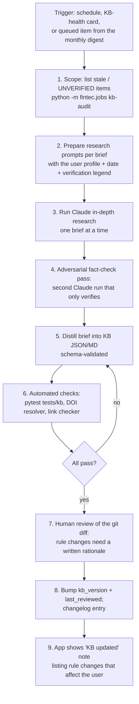

**Step details:**
1. **Audit.** `kb_audit` lists:
   - items past `stale_after_days`
   - `[UNVERIFIED]` / `[PARSE-UNCERTAIN]` tags
   - DOIs that failed to resolve
   - CMAs older than 12 months
   - limits files for the wrong year
   - creator `last_reviewed` older than 6 months
2. **Prompts.** Keep templates in `docs/research/prompts/`, one per brief. Each prompt includes:
   - today's date and the user profile (so the research is relevant)
   - the existing brief (so Claude updates rather than rewrites)
   - the verification legend ([V]/[S]/[UNVERIFIED]); primary sources only
   - "fetch primary sources directly when search is unavailable", as the 2026 briefs did
   - required output sections: Finding / Strength / Caveats / Program rule
3. **Research run.** Have Claude research one brief at a time:
   - academic evidence
   - each creator group
   - market context
   - savings/accounts
   - tech stack

   Use Claude Code (or opencode with a free model for lighter drafts [TS §4.2]) inside the repo, so output lands as a diff to `docs/research/*.md`.
4. **Fact-check pass.** Run a separate session with the instruction "verify every number, DOI, date, and quote; mark corrections inline as '(fact-check: …)'". The 2026 pass caught three wrong DOIs (Bessembinder, Anarkulova, Israelov & Nielsen) [CR-A §0.1a]. **Do not skip this step.**
5. **Distill.** Convert the brief into KB records (creator JSON per the schemas in [CR-A §7.2] and [CR-B §6.2]; paper records per [TS §2.6]). Numbers that change often go in `market/*.json`, `savings/*.json` or `accounts/limits_*.json`, never in prose [MC §9.3].
6. **Automated checks.** Run `pytest tests/kb` and `scripts/verify_citations.py`. The DOI resolver uses OpenAlex `works/doi:` and fails the build on a title mismatch. Do not auto-import author names from OpenAlex (it got Harvey-Liu-Zhu's third author wrong) [TS §1.10]. Run the link checker on video and source URLs.
7. **Human review.** Read the diff. Any change to `rules/*.yaml` (weights, caps, thresholds) needs a rationale line citing the evidence, and it is shown to the user as a "rule changed" notice.
8. **Version.** Bump `kb_version`, set `last_reviewed`, and write a `CHANGELOG.md` entry.

### 11.2 Adding (or updating) a creator
Example: adding a ninth channel, or re-reviewing Whiteboard Finance after the GRML promotion.

```mermaid
flowchart LR
    A[Candidate creator] --> B[Verify channel ID:<br/>handle page externalId + RSS title]
    B --> C[Impersonator check]
    C --> D[Claude research brief:<br/>credentials, philosophy, frameworks,<br/>dated positions, conflicts]
    D --> E[Fact-check pass]
    E --> F[Write knowledge_base/creators/slug.json<br/>principles + positions + conflicts]
    F --> G[Rate each principle A-E<br/>with evidence_refs]
    G --> H[Set trust_weight with written rationale]
    H --> I[Add channel ID to allowlist<br/>in creators/channels.json]
    I --> J[pytest tests/kb + review]
```

**Checklist:**
1. **Channel ID:** fetch `https://www.youtube.com/feeds/videos.xml?channel_id=<ID>` and the handle page's `externalId`. They must match. The RSS endpoint is flaky, so retry before concluding anything [TS §3.1].
2. **Impersonators:** search for look-alike channels and record known fakes as `blocked_channel_ids` (as with Sven Carlin) [TS §3.1].
3. **Research brief:** use the same structure as the existing creator briefs:
   - identity and credentials (verify via CFP Board / CFA Institute / FINRA BrokerCheck where applicable)
   - core philosophy
   - ETF vs. stock-picking stance
   - savings/HYSA stance
   - dated holdings
   - criticisms and conflicts
   - alignment with evidence
   - Note the jurisdiction: Canadian or UK creators need US translation [CR-A §1.1; CR-B §1.6].
4. **Record types:** separate `principle` / `framework` / `pick` / `commentary` / `product_mention`. Picks get `stale_after_days: 120`; commentary 60 [CR-B §6.1].
5. **Flags:** `sponsored`, `paid_promotion`, `creator_owned_product`, `self_reported`. Conflict records carry severity [CR-A §7.2].
6. **Evidence rating:** each principle gets A-E (or NA), with `evidence_refs` to `papers.json` IDs and an `evidence_note`. Any D principle, or any `risk_level: high` principle, gets `fit_for_profile: caution` at minimum [CR-B §6.1].
7. **Trust weight:** an editorial judgment (0-1) with a written rationale. Drop it for paid stock promotions, undisclosed sponsorships, legal issues, or platforms that failed [CR-A §5].
8. **Allowlist:** add the channel ID to `knowledge_base/creators/channels.json` (mirrored into `config.toml` at load). The weekly RSS job picks it up [TS §3.5].
9. **Copyright:** store paraphrased summaries, short quotes with attribution, timestamps, and links only. Raw transcripts stay in git-ignored `data/cache/transcripts/` [TS §3.4].
10. **Removing a creator:** set `active: false`. Keep history so that journal references still resolve.

### 11.3 Adding a paper
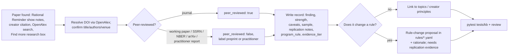

**Rules for papers:**
- **Sources of candidates:** Rational Reminder show notes (extract DOIs and SSRN links with a regex) [TS §3.2], creator video descriptions (Felix publishes zbib reference lists [CR-A §1.8]), OpenAlex search, and Semantic Scholar `tldr` for triage [TS §2.1-2.2].
- **SSRN:** link only; never scrape. Get metadata through OpenAlex [TS §2.4].
- **Required fields:**
  - `doi`, `title`, `authors`, `year`, `journal`, `peer_reviewed`
  - `finding_summary`, `strength` (Very strong / Strong / Moderate / Weak / Convention [AE §12])
  - `caveats`, `sample_period`, `markets`, `replication_notes`
  - `program_rule`, `evidence_tier` (canonical / contested / speculative)
  - `kb_topics`
- **Rule-change bar:**
  - A single new paper never adds a scoring signal by itself (Harvey-Liu-Zhu t > 3; Hou-Xue-Zhang replication) [AE §4.2-4.3].
  - A new signal enters as `speculative` with weight 0. It can move to `contested`, and only reach weight above 10% as `canonical`, after out-of-sample or international replication.
  - Apply the 50% post-publication haircut to any premium it reports [AE §4.1].
- **Contested pairs:** when papers disagree (e.g., Hou-Xue-Zhang vs. Jensen-Kelly-Pedersen on replication), store both and show both [AE §4.2].
- **Unverified numbers** (e.g., SPIVA percentages, Morningstar *Mind the Gap*) stay flagged until fetched from the live source, and are displayed as "approximate, as of <date>" [AE §0].

### 11.4 Refreshing market context and rates (quarterly / as published)
Follow [MC §9.3]:
1. Run `scripts/refresh_market_data.py`, which refreshes the DuckDB `macro` / `treasury_curve` tables and writes `data/market_snapshot.json` with a per-field `as_of`.
2. Update the "L" sources in `knowledge_base/market/*.json`: GTM, VEMO, LTCMA, BlackRock, AQR, FactSet.
3. If a regime indicator crosses a percentile band (CAPE above the 90th percentile, 10-yr real yield above 2.5%, HY OAS below 3% or above 6%, CPI y/y above 4%), regenerate the regime narrative, by LLM or by template.
4. Re-verify `[PARSE-UNCERTAIN]` values from chart PDFs by hand.
5. Twice a year (May 1 and Nov 1), update I bond rates by hand. Curate HYSA/CD rates weekly while the user is actively shopping [SA §5].

### 11.5 Before shipping any KB change
- `pytest` (unit + kb), `pytest -m live` weekly for data-source drift [TS §5.7].
- Golden test: a total-market ETF regresses to Mkt ≈ 1.0, R² > 0.95 [TS §5.7].
- The app runs end-to-end with `LLM_PROVIDER=none`.
- `CHANGELOG.md` lists user-visible rule changes; the `Home` page shows them on next launch.

---

## 12. Cadence cheat sheet

| When | Do | Time | Page |
|---|---|---|---|
| Once | Setup, IPS, $20K split | 2-3 h | `0_Profile`, `1_Savings…`, `2_Account…` |
| Each payday | Nothing. Contributions are automated | 0 | — |
| Monthly | Refresh, cash check, waterfall, rebalance check, creator digest, pending items | ~30 min | `Home`, `1_Savings…`, `2_Account…`, `4_Portfolio…`, `6_What_Experts_Say` |
| Quarterly | Regime + CMA refresh, ETF and stock reviews, thesis checks, plan update | 60-90 min | `Home`, `8_Market_Context`, `3_ETF_Explorer`, `5_Stock_Research`, `4_Portfolio…`, `9_Decision_Journal` |
| November | Next-year limits, open enrollment / HSA | 30 min | `2_Account…`, `11_Settings` |
| December | TLH + wash-sale check, 401(k) pace, backdoor pro-rata | 45 min | `4_Portfolio…`, `2_Account…` |
| January | Tax forms vs cash-interest summary, fund IRA/HSA, IPS review, annual report, KB refresh | 2 h + dev time | `0_Profile`, `2_Account…`, `4_Portfolio…`, KB |
| By April 15 | Finish prior-year IRA/HSA | 10 min | `2_Account…` |
| Event: new idea | Stock flow (§6) with 72 h cooling-off | 1-3 h over 3+ days | `5_Stock_Research`, `9_Decision_Journal` |
| Event: video hype | Anti-FOMO flow (§8) | 10 min + 72 h | `6_What_Experts_Say` |
| Event: drawdown ≥ 10% | Crash playbook (§7) | 20 min | `Home`, `4_Portfolio…`, `9_Decision_Journal` |

---

## 13. Open questions for the user (these inputs change the outputs above)

1. **Monthly essential expenses (M).** This single number decides how much of the $20K is investable (§2.3).
2. Job stability and industry; single or dual income; dependents.
3. 401(k) match formula and vesting; is the match currently fully captured? Plan fund menu and expense ratios? Roth 401(k) or after-tax contributions available?
4. Approximate MAGI and state of residence. These drive Roth eligibility and the T-bill vs. HYSA after-tax math.
5. HSA-eligible health plan?
6. Any credit-card or other debt above 8% APR? Student loans?
7. Known large expenses in the next 3 years (car, move, wedding, home down payment)?
8. 2026 contributions to date (IRA, 401(k), HSA), and any pre-tax IRA balances (backdoor pro-rata).
9. Current holdings by account, and where the $20K sits today (bank and APY; direct or fintech).
10. Answers to the three risk questions (drawdown, lump sum, tracking error), and which interests to enable: value/quality, factor ETFs, dividend growth, growth.
11. Starting satellite cap for individual stocks: 0%, 5%, or 10% of equities? The default is 10% (warn above it); the strong warning is at 20%.
12. Which LLM option, if any: none, OpenRouter free, or local Ollama?

*Educational decision-support playbook, not individualized investment advice. All figures are as of the dates shown and must be refreshed from the cited sources before acting.*
